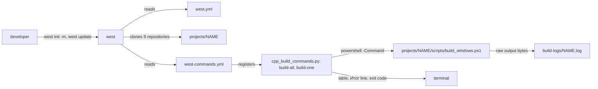

# cpp-west-workspace - documentation

cpp-west-workspace is the manifest repository of a [west](https://docs.zephyrproject.org/latest/develop/west/index.html)
workspace that holds nine C++ repositories (CppMiddleProject1 to CppMiddleProject8 and Mandelbrot-Fractal).
`west update` clones them from one manifest (`west.yml`), and two west extension commands, `west build-all` and
`west build-one`, build them on Windows by running each project's own `scripts\build_windows.ps1` and printing one
pass/fail table (`README.md:3-13`). Who the intended users are, beyond the owner, is not stated in the repository.

The requirements reverse-engineered from the code are in [`../SPEC.md`](../SPEC.md).

## Status

- Last commit of the project's own code: 2026-11-08 (`5e73f1a`, sources under the pinned ruff and mypy;
  `d606f08`, the test suites). Last commit overall: `63be24b`, 2026-11-08 (`git log`).
- Tests exist: `tests/test_cpp_build_commands.py` (24 test functions, 30 cases after parametrisation) and
  `tests/test_manual_list.py` (2 functions). A pytest run on 2026-11-18 confirmed it: 32 passed.
- CI exists as five Gitea workflows in `.gitea/workflows/` (`test.yaml` runs on a runner labelled `windows`,
  `.gitea/workflows/test.yaml:16`). Whether a runner serves this repository is not visible from the files;
  `CLAUDE.md` describes the case where none does.
- Evidently unfinished: the README lists five lab requirements not met, R-02, R-09, R-37, R-41, R-42, tracked as
  issues #8 to #12 (`README.md:40`); `tests/manual/tests.json` holds no manual tests (`"tests": []`).

## Layout

| path | what it is |
| --- | --- |
| `west.yml` | west manifest: one remote, nine projects with branch revisions, `self` entry that registers the commands |
| `west-commands.yml` | registers `build-all` and `build-one` from the Python module below |
| `scripts/west_commands/cpp_build_commands.py` | the two commands and their shared base class (one file, 626 lines) |
| `tests/test_cpp_build_commands.py` | unit tests of the module with a fake manifest and a fake `subprocess.Popen` |
| `docs/install.md` | prerequisites for building the nine projects and for working on the commands |
| `docs/manual.md` | options of both commands and the meaning of the result |
| `pyproject.toml`, `uv.lock` | Python packaging, pinned dev toolchain, pytest/mypy/ruff settings |
| `recipe.ps1` | lab task runner (see "Repository tooling") |
| `CLAUDE.md` | rules for work in this repository |

## Architecture

The repository contains no C++ code. It has two parts: data for west (`west.yml`, `west-commands.yml`) and one
Python module that west imports by file path (`west-commands.yml:1-11`, `cpp_build_commands.py:11-15`).

- `WindowsNativeBuildCommandBase` (`cpp_build_commands.py:219`) holds everything shared: argument definitions,
  project selection, running one build, serial and parallel runs, the summary table and the exit code.
- `BuildAllProjectsCommand` (`:516`) selects all manifest projects or those named by `--only`, and accepts `-j`.
- `BuildOneProjectCommand` (`:586`) selects one project by name and always runs serially.
- The actual build (MSVC environment, Conan, CMake preset, ctest) happens in each project's
  `scripts\build_windows.ps1`, which this repository does not contain (`README.md:20`, `cpp_build_commands.py:3-9`).



External dependencies at run time: `west` (Python), Windows PowerShell or `pwsh`, and whatever the projects'
scripts need (Visual Studio 2022 C++ workload, CMake 3.25+, Ninja, Conan 2, Git; LLVM/Clang 19+ for
CppMiddleProject8) per `docs/install.md:5-18`. The nine repositories are fetched from
`https://github.com/IGORSVOLOHOVS` (`west.yml:19-20`).

## Build and run

Prerequisites for building the workspace: the table in `docs/install.md:5-12` (Python 3.9 or newer with west,
Visual Studio 2022, CMake 3.25+, Ninja, Conan 2, Git). For working on the commands: uv and Python 3.13
(`docs/install.md:22`; `pyproject.toml` `requires-python = ">=3.13,<3.14"`).

Create and build a workspace (`README.md:5-11`):

```powershell
pip install west
west init -m https://github.com/IGORSVOLOHOVS/cpp-west-workspace cpp-west
cd cpp-west
west update
west build-all
```

If `west.exe` is not on PATH, `python -m west` works the same (`docs/install.md:16`).

Work on the commands from a clone of this repository (`docs/install.md:23-26`, `recipe.ps1:48-63`):

```powershell
uv sync --frozen               # installs west at the version uv.lock pins (1.5.0)
.\recipe.ps1 test              # version check, pytest, mypy, ruff check, ruff format
.\recipe.ps1 run <arguments>   # uv run --frozen python -m west <arguments>
.\recipe.ps1 build             # wheel with cpp_build_commands.py in dist\ (west does not use it)
```

## Configuration

The module reads no environment variables (`cpp_build_commands.py` uses only `os.name`). Its behaviour is set by
the manifest and by command-line flags.

| item | meaning | default | source |
| --- | --- | --- | --- |
| `west.yml` `projects[].revision` | branch each project is checked out at | `main`; `initial` for CppMiddleProject7 | `west.yml:25-61` |
| `west.yml` `projects[].path` | clone location | `projects/<name>` | `west.yml:25-61` |
| `west.yml` `self.west-commands` | file that registers the commands | `west-commands.yml` | `west.yml:70-72` |
| `--build-type Release\|Debug` | forwarded as `-BuildType` | `Release` | `cpp_build_commands.py:239-246` |
| `--clean` | forwarded as `-Clean` | off | `:247-251` |
| `--skip-tests` | forwarded as `-SkipTests` | off | `:252-256` |
| `--only NAME[,NAME...]` (build-all) | build only these; repeatable; case-insensitive | all projects | `:544-550` |
| `-j N`, `--jobs N` (build-all) | projects built at once; must be at least 1 | `1` | `:551-561`, `:566-567` |
| `PROJECT` (build-one) | one project name as in `west.yml`, case-insensitive | required | `:609-613` |
| build script path | fixed: `scripts/build_windows.ps1` inside each project | - | `:45` |
| log directory | fixed: `build-logs/` at the workspace top | - | `:52`, `:418` |

`recipe.ps1` additionally reads `.claude/.env` into the environment when it exists (variables already set win,
`recipe.ps1:34-43`) and uses `LAB_SHARE` as the target of `publish` (`recipe.ps1:64-73`). `.claude/.env` is
gitignored here.

## Usage

All commands run inside a workspace made by `west init` and `west update` (`docs/manual.md:3`).

| scenario | command | source of the behaviour |
| --- | --- | --- |
| build everything, output streamed live | `west build-all` | `cpp_build_commands.py:425-438` |
| quick check of two projects without ctest | `west build-all --only CppMiddleProject1,Mandelbrot-Fractal --skip-tests` | `:294-302`, `:190-194` |
| several projects at once, output only in logs | `west build-all -j 3` | `:440-457`, `docs/manual.md:14` |
| rebuild one red project from scratch | `west build-one cppmiddleproject7 --clean` | `:272-291`, `:617-626` |
| Debug configuration (hours for some projects) | `west build-one CppMiddleProject1 --build-type Debug` | `:243-245` |

Each project ends as `OK`, `ПРОВАЛ`, `НЕТ СКРИПТА` or `НЕ СКЛОНИРОВАН`; only `OK` counts as success, and the exit
code is 1 when any project is not `OK` (`docs/manual.md:31`, `cpp_build_commands.py:54-61`, `:504-513`). The
summary has this shape (layout from `cpp_build_commands.py:477-502`, not a captured run):

```text
======================================
ПРОЕКТ  СТАТУС  ВРЕМЯ
--------------------------------------
<name>  <outcome>  <duration>  (<detail, when there is one>)
======================================
Итог: собрано N из M
Полные логи: <workspace>\build-logs
```

## Testing

`.\recipe.ps1 test` (`recipe.ps1:82-109`) checks that `$Version` in `recipe.ps1` equals the `[project]` version in
`pyproject.toml`, sets `core.hooksPath`, then runs `pytest`, `mypy`, `ruff check .` and `ruff format .` (in place)
through `uv run --frozen`. pytest options live in `pyproject.toml`: coverage of `scripts/west_commands` with
`--cov-fail-under=99`; the file records "220 of 220 statements, 100%" measured on adoption, and the run of
2026-11-18 measured the same.

What the tests cover (`tests/test_cpp_build_commands.py`): duration formatting, byte decoding and the stdout
fallback, PowerShell quoting and the full command line, `powershell`/`pwsh` lookup, name splitting and
case-insensitive selection, unknown names, the four outcomes, log writing, serial and parallel `build-all`,
`--only`, `--jobs 0`, missing PowerShell, an empty selection, `build-one` with Debug, and loading the file the way
west loads it. No build runs: `subprocess.Popen` and `shutil.which` are replaced and the manifest is a fake
(`tests/test_cpp_build_commands.py:1-5`).

Not covered: the contents of `west.yml` (no test parses it), the registration through `west-commands.yml`, a real
PowerShell process, and any of the nine projects' scripts.

## Known limitations and problems

- Builds are native Windows builds. On Linux/macOS the error text points to each project's `.devcontainer`
  (`cpp_build_commands.py:410-414`). Inference from `:145-154`: on a non-Windows machine with `pwsh` installed the
  command does not refuse and runs the Windows script.
- Revisions are branch names, not commits (`west.yml:25-61`), so what `west update` fetches changes as those
  branches move (inference).
- The manifest says each revision is the repository's default branch and that CppMiddleProject7 "has never had a
  main branch" (`west.yml:11-16`, `README.md:17`). Local clones of the nine repositories made on 2026-11-18 show
  `origin/HEAD` pointing at `release` for CppMiddleProject1 to 8 and a `main` branch in CppMiddleProject7 (without
  `scripts/build_windows.ps1`). At the pinned revisions those clones do carry the script. Not checked against the
  GitHub API.
- With `-j` above 1 the projects share one Conan cache (`cpp_build_commands.py:557-560`); the module does not
  coordinate them.
- Each run overwrites `build-logs/<project>.log` (`open(..., "wb")`, `:353`). Logs are raw bytes (`:362`), so they
  can mix UTF-8 from PowerShell with the OEM code page of native tools (inference from `:99-105`).
- There is no timeout on a build (`:354-365`): a hanging script holds the command.
- Inference from `:294-302`, `:569-571`, `:473-475`, `:511-513`, not run: `--only ,` yields an empty selection,
  which prints a warning and exits 0.
- Creating `build-logs/` happens outside the `try` block (`:349`), so an `OSError` there is not turned into a
  `ПРОВАЛ` row.
- Program output is Russian while the documentation is English.
- The lab requirements link in `README.md:40` points to a loopback address, which public readers cannot open.

## Repository tooling

The repository follows [repo-quality-template](https://github.com/IGORSVOLOHOVS/repo-quality-template), lab
requirements revision 4.0.0, except R-02, R-09, R-37, R-41, R-42 (`README.md:40`). Specific to this project:

- `recipe.ps1` variables: `$Name = 'cpp-west-workspace'`, `$Code = 'cww'`, `$Version = '1.0.0'` (must equal
  `pyproject.toml`), `$Needs` and `$Tools` empty, no `$App` ("A console tool with no window goes as a library"),
  `$Provides = @('scripts/west_commands/cpp_build_commands.py')`, `$Reviewers = @('igors')` (`recipe.ps1:11-25`).
- Verbs that act: `build` (wheel into `dist\`), `run` (`python -m west` with the arguments), `test`, `publish`
  (needs `LAB_SHARE`), `clean` (`dist`, `build`, `out`, `.coverage`), `info`. `install` and `uninstall` only print
  that there is nothing to do (`recipe.ps1:47-81`).
- Deviation: `.claude/.env` is gitignored and no key is committed, a reversal of R-02 (`CLAUDE.md` rule 4,
  `.gitignore`).
- `tests/manual/tests.json` is present with an empty list.

## Related documents

- [Project README](../README.md)
- [Requirements specification](../SPEC.md)
- [Install](install.md)
- [Manual](manual.md)
- [Rules for work in this repository](../CLAUDE.md)
- [Contributing](../CONTRIBUTING.md)
- [Licence (MIT)](../LICENSE)

## About this document

Written on 2026-11-18 from commit `63be24b` (branch `release`). Every statement cites the file it comes from;
inferences are labelled.

Commands run to check it: `git ls-files`, `git log`, `git show --stat 7392960`; a comparison of the file list with
the template clone; `python -I` with `ast.parse` on `cpp_build_commands.py` (parses) and `yaml.safe_load` on
`west.yml` (9 projects) and `west-commands.yml` (2 commands) using a global PyYAML 6.0.2, not the locked one;
`git ls-tree` on the remote branches of local clones of the nine projects.

Run during the check: pytest (32 passed, 220 of 220 statements covered), `ruff check`, `ruff format --check` and
mypy, all green, with the pinned versions (west 1.5.0, pytest 8.4.2, pytest-cov 5.0.0, coverage 7.15.2,
ruff 0.16.1, mypy 2.3.0) on Python 3.13.3 in a temporary virtual environment outside the clone, installed by
version rather than from `uv.lock`.

Not run: `.\recipe.ps1 test` itself, the `west` command line, any build of the nine projects.
